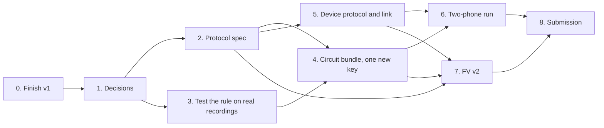

# Roadmap: v1 to the submission

Written 2026-11-06. A plan, nothing here is built. Sizes are guesses. Details live in the notes linked below, and this file only says what comes in what order.

Changed 2026-11-11 by [ADR 0001](v2/adr/0001-direct-webrtc-link-and-plain-words.md): a direct WebRTC link replaces the mailbox, a browser is in, and the v2 words changed.

## The submission

Two changes, shipped together as v2:

1. **Fix the detection rule**, so silence and the tone stop passing.
2. **Remove the server**, so no party can forge a verdict or collect recordings. Devices run the protocol between themselves, over a direct WebRTC link. No server takes part in a run.

What we can say after v2: nobody in the middle decides the result, anyone can recheck it, and a proof shows the recording passes a rule that silence and the tone fail.

What we can't say: "proven proximity". A device can still sign a false gap unless the reader requires its proof (decision 2). A helper standing next to the partner still works (CN4, CN5). Sound can't show who held the phone.

## Order

## Stages

### 0. Finish v1. In progress

Circuit proofs are done. The server proofs are running (`v1/server`). Then the owner decides on a commit. Two spec defects from the last review have to be fixed before this closes.

The server proofs still pay off after removal. The verdict math moves to the devices unchanged (F9), and the state machine shows what the devices must now enforce.

### 1. Decisions. Small, blocks everything

See "Decisions" below.

### 2. Protocol spec. Medium

Start from `v1/informal-spec.md` Part 2 (F1 to F11, FP1 to FP6). It's a draft that nobody has reviewed. Review it first and try to break it. Output: `v2/spec.md`.

It has to answer the jobs the server does today:

| Server job | Replacement | Hard part |
|---|---|---|
| Secret sounds | Each device picks a seed, sends its hash, and sends the seed after the partner's recording hash (F2, F3, F6) | Port the generator from numpy to Kotlin, and match it across platforms |
| Order of sending | Each side refuses to send its seed early | A cheater can walk away. That blocks a run and wins nothing |
| Start time | Agreed over the link (F4) | Never tried on iPhone to Android or a browser |
| Verdict | Both devices compute it (F9) | None. `PopDsp.flightCm` exists unused |
| Blind gap | Send the hash of the transcript first (F8) | Last sender ends up holding the full log (FN1) |
| Vouching for devices | See decision 3 | **Unsolved** |
| Credential in the circuit | Circuit takes the keys instead (open choice 3) | Circuit change |

The devices talk over a direct WebRTC link, set up by a QR code in each direction (ADR 0001, 2026-11-11). The earlier plan was a mailbox server first (`research/2026-11-05-layers-and-removing-the-server.md`).

### 3. Test the rule on real recordings. Small, do this early

Before touching a circuit, run the filtered-match rule offline on the recordings we already have, and on new real walks if needed. If honest phones stop passing, the rule needs redesigning, and this is the cheap time to learn it. Work out the exact `BAR` and bit widths here. Details: `v1/next-version-fixes.md` fix 1 and 2.

### 4. Circuit bundle. Medium

Every circuit change needs a new verifier key, so these go in once:

| Change | Why |
|---|---|
| Match on filtered audio, loudness floor | The rule fix |
| Drop the issuer, take the keys instead | No server to issue |
| New `code_commit` binding, with `c_q` in template energy | Devices now choose codes, so the all-128 code reopens (gap 5) |
| `xa`, `xb` public in `pair` | EVP needs them, waiting on this bundle (`research/2026-11-06-decouple-ens-safe-worldid.md`) |
| An optional extension value, bound by the transcript signature and the proof | So an implementer can attach device attestation later without a new key (decision 3). Not designed |
| Capture length, pinned public inputs, `pair` tied to phone proofs | For implementers who require proofs (decision 2) |

Then the same rule in `Popt2Rule.kt`, plus a real `bb prove` on the crafted cases, which has never been run.

### 5. Device protocol and link. Large

Start with a test of the WebRTC link (ADR 0001, "Not tested"). Then the Kotlin generator, the hash messages and value messages, the verdict on the device, and the two QR codes. Android first, then a browser as the second device. Calibration moves to the device, and v1 transcripts go away.

The decoupling work is what makes this possible: the presence record survives without the server, and only its signature goes away.

### 6. Two-phone run. Needs the owner

Nothing else covers real audio. Honest phones must still pass, at real distances, on real rooms. Rerun `circuit-cases`: silence, click, tone and fake near should fail, the control should pass.

### 7. FV v2. Large

| Part | What happens |
|---|---|
| `v2/zkp` | Redo `Bar`, `Arrival`, `PartnerGlue`, part of `Freivalds`, `Chain`, block A. Add the score ceiling proof. Silence and tone theorems should flip. |
| `v2/protocol` | New: FP1 to FP6, two-party, one dishonest device. Lean or Tamarin, decide in stage 2. |
| `v2/app` | **This grows.** Today the app only runs its side. In v2 the server's rules live in the app, so the walk test and trace replay move here, and the Kotlin is what gets checked. |
| `v2/server` | Gone. No server takes part in a run. |

Review by risk, not everything from scratch. Files that didn't change get a rebuild only. Use a small walk test during reviews and the full one at the end.

### 8. Submission

Demo, what it does and doesn't prove, reproduce steps.

## If time runs short

| Priority | What |
|---|---|
| Must | Stages 1 to 6 over the WebRTC link: Android with Android, and Android with a browser |
| Should | `v2/zkp` redo, and FP1, FP5, FP6 in `v2/protocol` |
| Cut first | iOS, `v2/app` beyond the verdict, FP2 to FP4, block A redo |

## Out of scope

- World ID, Safe, ENS. They become examples with their own backends (decoupling plan). Today's Safe signature path still needs someone to sign; that belongs to the Safe example.
- STUN and TURN servers, so devices on different networks can't run (ADR 0001).
- Browser with browser runs.
- Live relay and helpers (CN3 to CN5).
- Hardware attestation for Android and desktop (CN6).

## Decisions

1. **Deadline.** What date is the submission? It decides how far the cut list goes. Decided 2026-11-11: no deadline, so the cut list is not in force.
2. **Do proofs count?** Without a server there's no one to require them. Decided 2026-11-11: proofs are optional. The core doesn't force them, and the implementer who builds on it chooses. EVP already checks proofs itself. Then a NEAR with no proof means "two keys signed two numbers", and the log has to say so. One bench found phone proving at 25 s and 1.74 GB, not rechecked.
3. **Who vouches for devices?** The decoupling plan says outside parties read results and vouching "stays a core job". Removing the server takes that job away. Options: each reader checks attestation itself (FN2, and Apple documents App Attest for server use, so peer checks are untested), or a separate small attestation service, or no vouching and every key is just a key. Decided 2026-11-11: vouching is optional. The core has none, and every key is just a key. An implementer can add attestation, and the stage 4 bundle should leave room for it (the extension value row).
4. **Web.** Decided 2026-11-11 (ADR 0001): a browser is in, paired with a phone over the WebRTC link. The laptop has no prover, so only the phone can attach a proof. EVP needs the laptop as role A.
