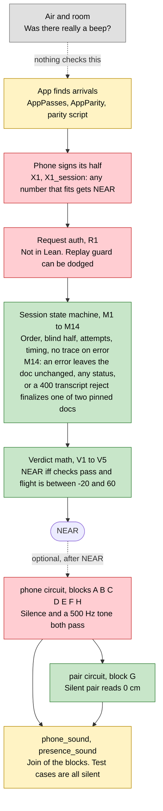
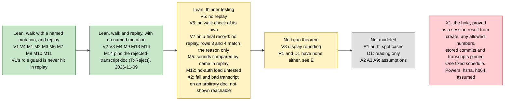
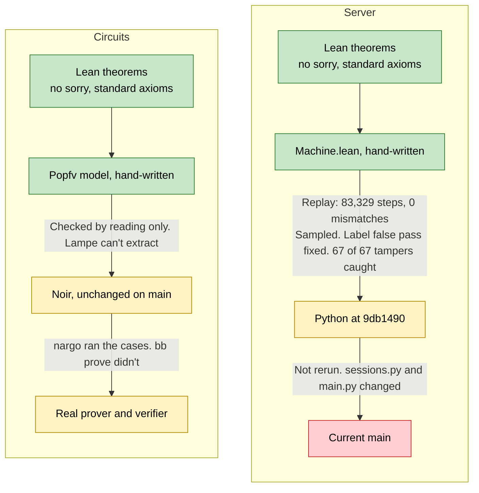

# Coverage: what's checked, and where it fails

Summary of [`../server/README.md`](../server/README.md) and [05-spike-results.md](05-spike-results.md). Those files have the evidence. Server work is pinned to `main` at 9db1490.

Colors: green is proved in Lean on a hand-written model. Yellow is tested or partly covered. Red is a known hole. Grey is not covered.

The last re-reviews of the server `spec.md` and `Machine.lean` passed, and so did the last critic. The `Verdict.lean`, `test_walk.py`, `Commit` and `Chain` re-reviews failed, and their fixes were not reviewed again. The Lean files added on 2026-11-07 had one chunk review each, no track review. On 2026-11-09 Codex (gpt-6-astra) reviewed again; the M14, `X1_session`, checker and replay fixes passed its re-review with low items open, and the doc fixes were not re-reviewed (report: [`../server/reviews/2026-11-09-codex.md`](../server/reviews/2026-11-09-codex.md)). So green doesn't mean a reviewer signed it off. Diagram 3 shows why.

## 1. The path to NEAR

Live NEAR takes the top route, from two signed numbers. The circuits run only after it, and nothing requires them.

## 2. Server properties by strength

## 3. Where the chain from proof to real code is weak

A theorem is only about the model. Each arrow is a step that has to hold before it says anything about what runs today.

## Last review per track

| Track | Reviewer | Last verdict | Status after |
|---|---|---|---|
| `spec.md` | Opus, last round not recorded | pass, on re-review | Nits fixed after |
| `Machine.lean` | Opus, last round not recorded | pass, on re-review | Its `spec.md` nits fixed. 34 of 34 mutants break |
| `Verdict.lean` | Opus, last round not recorded | fail, on re-review: `X1_on_layout` docstrings | Docstrings now say what each statement pins, `X1_on_layout_keys` pins recording values. Not re-reviewed |
| `test_walk.py` | Opus, last round not recorded | fail, on re-review: run records | Not re-reviewed as a track. Its 2026-11-09 fixes passed Codex. Full walk on the current file, 62 passed |
| `Replay.lean` | Codex | fail, false pass | Fixed in code, gaps 15 and 16 added. Chunk reviews passed, no track re-review. Its 2026-11-09 fixes (recording length, `?`) passed Codex |
| Whole work, critic | Codex, then not recorded | pass, on the second critic | Its open items are listed in the server README |
| Circuit `Commit`, `Chain` | Opus, last round not recorded | fail, on re-review: wording and unlogged mutants | Wording fixed, mutants logged in `zkp/logs/chain-mutants.txt`. Not re-reviewed. See [05-spike-results.md](05-spike-results.md) |
| Circuit `Freivalds`, `Signed` | Opus | pass | See [05-spike-results.md](05-spike-results.md) |
| M14 fix, 2026-11-09 | Codex astra, Opus checked | pass | `TxReject` pins the doc. Open: no status limit on the unchanged case, combine reason, `M14_any` |
| `X1_session` fix, 2026-11-09 | Codex astra, Opus checked | pass | `X1Reached` pins run and stored values. Open: symmetric layout instances |
| Checkers, 2026-11-09 | Codex astra, Opus checked | pass, round 2 | Open: allow-list dots, empty argument, `owner()` |
| Replay and walk fixes, 2026-11-09 | Codex astra, Opus checked | pass | Open: `REPLAY_ONLY` matching nothing exits 0 |
| Docs, 2026-11-09 | Codex astra, first pass only | not re-reviewed | Fixed after the first pass |
