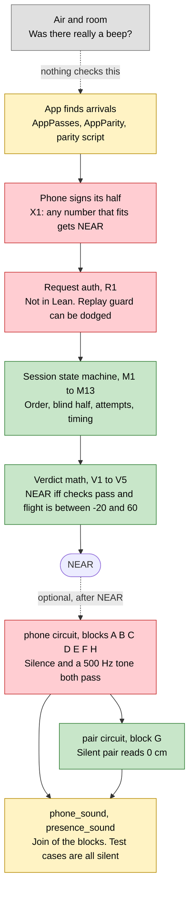
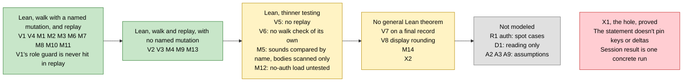
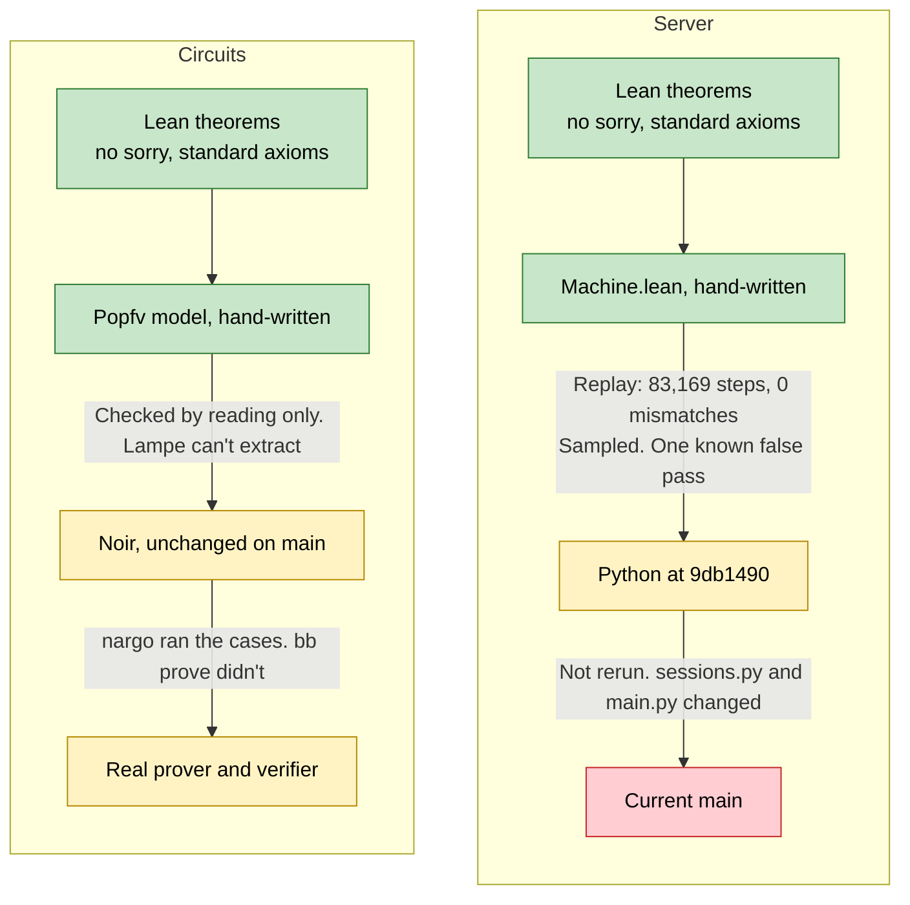

# Coverage: what's checked, and where it fails

Summary of [`../server/README.md`](../server/README.md) and [05-spike-results.md](05-spike-results.md). Those files have the evidence. Server work is pinned to `main` at 9db1490.

Colors: green is proved in Lean on a hand-written model. Yellow is tested or partly covered. Red is a known hole. Grey is not covered.

Every review track ended on a fail, so green doesn't mean a reviewer signed it off. Diagram 3 shows why.

## 1. The path to NEAR

Live NEAR takes the top route, from two signed numbers. The circuits run only after it, and nothing requires them.

## 2. Server properties by strength

## 3. Where the chain from proof to real code is weak

A theorem is only about the model. Each arrow is a step that has to hold before it says anything about what runs today.

## Last review per track

| Track | Reviewer | Last verdict | Status after |
|---|---|---|---|
| `spec.md` | Opus | fail | Fixed, not re-reviewed |
| `test_walk.py` | Opus | fail, never finished | Final walk passed, not re-reviewed |
| `Verdict.lean` | Opus | fail, `X1` overclaim | Wording narrowed, statement not strengthened |
| `Machine.lean` | Opus | fail, two doc claims | Fixed, 21 of 21 mutants broke, not re-reviewed |
| `Replay.lean` | Codex | fail, false pass | **Not fixed** |
| Whole work, critic | Codex | fail, real gaps | **Not fixed**, listed as known gaps |
| Circuit `Commit`, `Freivalds`, `Signed`, `Chain` | Opus | see [05-spike-results.md](05-spike-results.md) | Last `Chain` wording fixes not re-reviewed |
