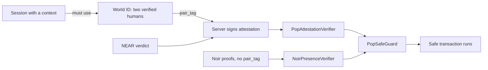
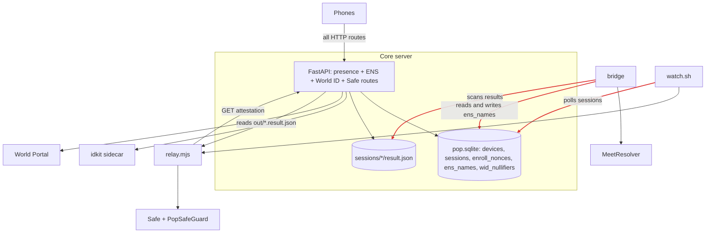
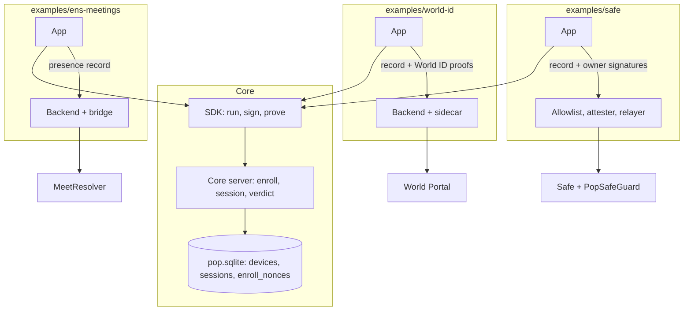
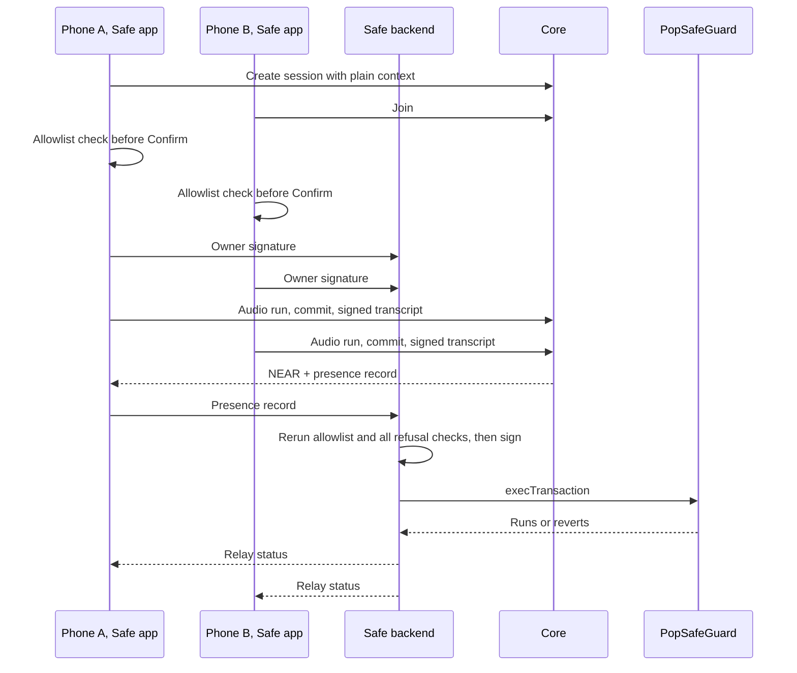

# Plan: make ENS, Safe and World ID examples built on the core proximity proof. 2026-11-06

Goal: the core does one thing, two enrolled devices were near each other. ENS, Safe and World ID become example use cases in `examples/`, each its own app and build, each integrating the core the way an outside developer would. SQLite stays for now. This is also the first move toward removing the server, see `2026-11-05-layers-and-removing-the-server.md`.

Status: a plan, read from `main` at 9db1490. Nothing here is built. Effort numbers are guesses. The server tests were not run for this note.

## The main finding

These are not three separate dependencies. Safe and World ID are welded together, and ENS is tangled in a different way.

- A session with a `context` must use World ID: `parse_session_in` refuses anything else (`server/pop/main.py:166`).
- The attestation won't be signed without two verified humans and a `pair_tag` (`server/pop/chainatt.py:42-45`). The `pair_tag` is inside the signed digest (`PopAttestationVerifier.sol`).
- So Safe through the attestation path needs World ID. Safe through the Noir path (`NoirPresenceVerifier.sol`) doesn't touch `pairTag`, but its own comments say human uniqueness "stays a server claim".



The weld is only in the server, not on chain. `PopAttestationVerifier.verifyPresence` hashes `pairTag` into the digest and checks the signature, and that's all it does with it. So a Safe example can stop using World ID with **no contract redeploy**: it signs a fixed `pairTag`. The guard already requires two registered devices belonging to two different owners (`PopSafeGuard.sol:265-269`). What's lost is "two Orb-verified humans": one person holding both owners' phones could spend. See decision 2.

The good news: the core is already separable. `test_flow_v2`, `test_flow_fake_phones`, `test_zk`, `test_pairing`, `test_arm_commit` and `test_public` never mention World ID, Safe or ENS. That's why the gate in step 2 is realistic.

## Where it's tangled

Today, everything meets inside the core. The red arrows reach straight into its database and files:



| Where | What | Fix |
| --- | --- | --- |
| `main.py:162-190` | Contexts force World ID and a registered kind | Core keeps a plain context: chain, consumer, hash. No kinds, no human rule |
| `main.py:283-284` | `WorldID` and `Names` are always constructed | Move out |
| `main.py:265-268` | World ID settings can stop the server starting | Move out |
| `main.py:334, 349-352` | `/health` and `/v1/config` carry World ID and Safe blocks | Remove. The app ignores extra config keys and only checks its own table (`PopConstants.kt`), and the keys it does read are optional |
| `main.py:493-505` | ENS routes | Move out |
| `main.py:535-551` | World ID routes | Move out |
| `main.py:664-666`, `chainatt.py` end | Bundle and attestation add Safe owner signatures | Safe example merges them |
| `main.py:669-677` | `/relay` reads the relayer's files from disk | Move out |
| `main.py:786-800` | Safe owner signature route | Move out |
| `sessions.py:233` | Arm is blocked until both humans verify | Move the gate to the app, and the real check to whoever signs |
| `sessions.py:662` | Nonce shows early only under the World ID policy | Plain session option for an early nonce, because World ID must sign it before confirm |
| `PopController.kt:515`, invite | The guest learns World ID is needed from `policy` in the join view | Not needed. Both phones run the same example app, so the app already knows its own flow |
| `sessions.py` result and views | `human` block in records and views | Move out |
| `consumers/__init__.py` | `safe-tx` is always registered | Move out |
| `bridge/bridge.py:286-312` | Bridge reads and writes `ens_names` in the core's database | ENS example owns its names |
| `bridge/bridge.py:351` | Bridge scans `sessions/*/result.json` on disk | Receives the presence record |
| `relayer/watch.sh` | Polls the core's `sessions` table with `sqlite3` | Receives the presence record. Only `relay.mjs` uses HTTP today |
| `chainatt.py:54-55` | Reads the device row for platform | Put platform in the record |
| `tests/conftest.py:18-22` | World ID settings injected into every test | Move to each example's tests |

The Fix column is the end state. Old paths keep working until step 4 is on the phones.

## The one new thing: a presence record

Examples never read the core's database, files or session document. They get a **presence record**: `session_nonce`, `context`, `not_before`, both signed transcripts, device public keys, `attested` and `platform`, `flight_cm`, verdict, ZK block, plus the core's signature over all of it with a new key, not `attest.pem`. It also carries each device's attestation evidence and a trust tier (`strongbox`, `tee`, `software`, and so on), so an outside party can check the devices itself rather than trust an `attested: true` flag.

This is §8.4's result without the `human` block. Phones already fetch that result, so **each example app hands the record to its own backend**. No new feed from the core.

One real trade-off: today `bridge` and `watch.sh` act with no phone involved. With this, a phone that dies right after the result means no ENS record or Safe send until it retries. Mitigation: either phone can deliver, delivery is idempotent, and the app retries from a small local queue. For a Safe send, the phones are waiting on the result anyway.

Why this shape: when the server goes, the phones still have two signed transcripts. Only the core signature disappears, and an example or a contract rechecks the halves instead. Everything above this line keeps working.

## What goes where

```
core/                      the product
  server/                  enroll, sessions, verdict, ZK routes, presence record
  sdk/                     Kotlin library: audio run, DSP, transcripts, signing, pairing, ZK, core API client
  prover/, zkprove/        native proving, iOS framework
  circuits and verifiers   phone and pair circuits, generated verifiers
  reference-app/           minimal app: enroll, pair, run, show the result. Today's app/, cut down
examples/
  ens-meetings/            app, backend (name claims + bridge), MeetResolver
  world-id/                app, backend (human.py + sidecar), two different humans who met
  safe/                    app, backend (allowlist + attester + relayer), PopSafeGuard, P256Owner
```

`examples/` over `use-cases/`: it says "copy this to build yours". Folder names are a suggestion; moving `server/` and `app/` under `core/` is optional and can wait.

**Rule: an example only uses what an outside developer could use.** The published SDK, core HTTP routes and the presence record. No imports from the core's internals, and no example imports another example. If an example needs something more, that's a gap in the core's API, and it gets fixed there.



Each example keeps its own database. `ens_names` goes with ENS and `wid_nullifiers` goes with World ID. A Safe spend in this shape:



Core processes: server and tunnel, two instead of five.

## What separate apps change

Separate apps are a cleaner design, but there are real consequences:

| Consequence | Why | What to do |
|---|---|---|
| The core must become a library | Today there's one module (`include(":composeApp")`), with Safe, ENS and World ID mixed through `PopController.kt` and `App.kt` | This is the biggest new work, see step 4 |
| One phone holds separate identities | Device keys live in Android Keystore and the iOS keychain, per app. So each example enrolls and calibrates by itself | Fine for examples. Say so in each README |
| Existing Safes stop matching | The guard registers device keys, and a new `applicationId` means new keys, so it answers `UnknownDevice` | On Sepolia, create a new Safe. The guard's device rotation is the other route |
| Each app is its own iOS and Android build | Bundle IDs, App Attest, the `enconomy://worldid` return link, and shipping the prover (123 MB and 178 MB in `dist/`) | Start with Android, add iOS where it's wanted |
| Three apps to keep working | Every SDK change can break them | Build all examples in CI, and keep each one small |
| Web is an open question | The Kotlin/Wasm target has to survive the split | Keep web in the reference app first |

## Security checks that must move, not vanish

These checks exist today because the core runs them. If they get dropped by accident, nothing fails loudly.

1. **The Safe allowlist.** `safe_tx.allowlist` refuses self-calls and unknown calls at session creation. The guard blocks delegatecall, gas refunds and some self-calls, but allows any external call and `setGuard(0)`. The confirm screen (`App.kt` `SafeTxPanel`) shows `to`, ETH amount and nonce, not `data`, so a token `approve` reads as "0 ETH". Today the server's allowlist is the only thing refusing that. It must run in the Safe backend before signing, and also in the Safe app before Confirm, so an honest phone refuses by itself once no server is there. New test: a refused transaction with a good NEAR gets no attestation.
2. **All refusal checks in `chainatt.refusal`.** NEAR, context match, production environment, attested devices, chain. Same order. The human check goes only if decision 2 drops it, and then the README must say a Safe spend no longer proves two humans.
3. **World ID's human gate.** In `examples/world-id`, a patched app can skip the gate and run audio. That wins nothing as long as the backend refuses, so the backend's check is the one that counts. It should also confirm the World ID signal matches this record's nonce, which is how `docs/pop-human-adapters.md` §2 designed the signal.
4. **The nullifier table.** Copy all rows. Starting empty would let old proofs be reused.
5. **Keep `attest.pem` and the digest unchanged.** Then the deployed guard needs no redeploy. The key moves to the Safe example and leaves the core.
6. **ENS name rule.** Today only an enrolled device can claim. The ENS backend has no device table, so the claim is signed by the device key. The app asks for the name right after calibration. See the open decision on when it goes on chain.
7. **Secrets per example.** Each backend holds only its own: `worldid-rp.key`, `attest.pem`, the Sepolia keys. Examples ship with `.env.example`, never real keys.

The core's own weaknesses in `SECURITY-TODO.md` are not touched here.

## Steps

Each step ships alone. Today's app and `./demo` keep working until step 6.

**1. Presence record and Android root pin (additive, about a day).** Add the record to the result, plus the plain context path. Pin Google's root in `attestation.py`, whose header says it isn't checked today, because outside readers and the ENS claim both rely on it. Nothing removed.

**2. Switch in core (about half a day).** `POP_ADDONS=0` builds no World ID, names or Safe, and refuses their routes. Move the conftest settings behind it. `test_popctx` mixes pure nonce vectors with World ID session flows, so split it. **Gate: every test except `test_ens`, `test_safe_tx`, `test_worldid` and the flow half of `test_popctx` passes with it off, and everything passes with it on.** This is the first visible win: a lean core can already run.

**3. Example backends, one at a time (2-3 days).**
- ENS first, because it depends on nothing. Copy the 3 rows. `bridge` stops using the core's database.
- World ID next. `human.py` is written around the session document, so it needs its own per-session state, keyed by nonce and role. Copy `wid_nullifiers`. Device requests are self-contained: public key plus signature, since there's no device table.
- Safe last. `watch.sh` becomes a queue fed by the app. `/relay` moves here.
- Move the tests with them: `test_ens` 4, `test_safe_tx` 17, `test_worldid` 26.

**4. Core SDK and reference app (3-5 days).** The largest step. Split `app/` into a library module and a thin app. Library candidates: `dsp/`, `zk/`, `AudioRun`, `RunFlow`, `Transcript`, `Signing`, `Invite`, `Pairing`, `Calibration`, `ClockSync`, `HolderStore`, `PopCtx`, core routes from `PopApi`, and `ui/` for shared widgets. Take Safe, ENS and World ID out of `PopController.kt` and `App.kt`, about 125 matching lines each. Examples consume the SDK as a Gradle composite build, with no publishing needed yet. **Needs a real two-phone run from you**, since nothing else covers the audio. This is the proof the core works alone.

**5. Example apps, one at a time (1-2 days each, Android first).** Same order: ENS, World ID, Safe. Each gets its own `applicationId`, a small UI and a README saying what it proves and what it doesn't. World ID runs before Arm, as `pop-human-adapters.md` §1 rule 2 requires for iOS. The Safe app gets the allowlist and a confirm screen that shows what the transaction does. Two-phone run for each. Move `MeetResolver`, `PopSafeGuard`, `P256Owner` and their tests into their examples last. Deployed addresses aren't affected.

**6. Delete from core (about half a day).** Only after step 5 works on phones. Old builds break here. Remove the switch and the code. Update `./demo`, `README.md`, `docs/pop-contract.md` and `docs/pop-human-adapters.md`, whose §1 has the core enforcing human rules. Its §5 already says composition happens at the verifier.

Total: about 2-3 weeks.

## Calibration, sessions and enrollment when the server goes

You asked whether these become hard dependencies. Calibration no. Sessions and enrollment are hard because of what the server does, not what it stores.

| Data | Today | Without a server | Difficulty |
| --- | --- | --- | --- |
| Calibration | App keeps it (`Calibration.load()`). POPT v2 folds it into the signed number, so the verdict uses cal 0 (`calibration.py`). Only v1 needs the server's copy, and it's the fallback at rates with no circuit (`RunFlow.kt`) | Device only | **Easy.** Drop v1 and read the local value first (`PopController.kt:934` prefers the server's copy today). Rates with no circuit need an answer first |
| Enrollment: key | Public key in `devices`; used for request auth | The transcript already carries it | **Easy** |
| Enrollment: credential | Phone holds SBcred3 (`HolderStore.kt`). The server row is a copy checked at `sessions.py:617-621` | Issuer signature is a public circuit input (`phone` circuit), so someone must issue or the circuit changes | **Hard:** circuit change, new proving keys |
| Enrollment: attestation | Server checks chains | Partners check each other. Apple documents App Attest for server use, so this is untested | **Hard** |
| Session: the document | Short-lived, nothing needs it after the result is written | Gone, or a mailbox | **Easy** |
| Session: its jobs | Secret sounds (numpy), order of reveal, start time, verdict | Generator ported to Kotlin, commit then reveal between phones, a link between them | **Hard**, see the 11-05 note |

Three rules while doing this, so none of it gets worse:

1. Examples only ever see the presence record and the public API.
2. No new code reads `devices` or the session document from outside the core.
3. Don't change the circuits for this work.

## Not solved here

- **World ID without a server.** Only a server calls the Portal today, and the 11-05 note marks this "not studied". The World ID example keeps a small backend, and that's fine: it's an example. It only matters if that example has to run with no server at all. The Safe example has the same question about who signs, and the Noir path answers it.
- Removing the server itself, the mailbox and the direct phone link.

## Decisions

Decided by the user, 2026-11-06:

- **Each example is its own app** integrated with the proof.
- **Consumers of the result: the two people, contracts and outside parties.** So vouching for devices stays a core job.
- **Safe drops World ID.** The three examples are independent. One person with both owners' phones can spend, and the Safe README must say so.
- **World ID gate moves to that example's app.** Its backend stays the real check.
- **ENS: the app claims a subname right after calibration, and it goes on chain at the claim.** Each claim spends gas from a hot key, so the backend accepts only attested phones, with no daily cap. Attestation only limits who can claim if the Android root is pinned (step 1).
- **Android first.**
- **Start as soon as this plan is final.**
- **This pass: backends, contracts, tests and docs only.** One worktree per decoupling. No app builds and no example apps yet, so the transitional `POP_ADDONS` switch is skipped and code moves directly.

## A fourth consumer: EVP recovery

Added 2026-11-06. `research/ethglobal-mumbai/evp-recovery` is expected to become `examples/evp-recovery` once these three are done. It doesn't change this pass, but the core shouldn't close off what it needs. Its progress report is in that folder.

It's a useful test of the rule above, because it's the first consumer that checks the proofs itself and has no use for the core's signature. It needs these from the core:

| Need | Today | What the core should allow |
| --- | --- | --- |
| A session bound to a context the example defines | `parse_session_in` only takes kinds from `consumers.kinds` | An example can supply a context without adding a kind inside the core. The nonce is still fixed from `ctx_hash` at create |
| A context with no World ID | A context forces `policy.human = worldid` (`server/pop/main.py` 166-167, 188-190) | Human policy separate from context. Safe dropping World ID needs the same thing |
| Another chain | One `POP_CHAIN_ID` | The session's chain comes from its context. EVP uses 1337 |
| The creator is role A | Yes (`sessions.py` `role_of`). EVP needs laptop = A, so the laptop creates | Keep this stable, and document it |
| All three raw proofs and their POPCC1 signatures | The record has a ZK block | The ZK block carries everything a contract needs to verify, with no call back to the core |
| A credential for a brand-new phone and for a laptop | Issued at enrollment. A web device gets no attestation | A new phone can enroll before its first chirp. The laptop's tier stays visible as `software` |

Not asked of this work:

- **The circuit change.** EVP needs `xa` and `xb` public in a pair circuit. That waits until `fv/v1` is done and gets decided with `fv/v2`.
- **The EVP issuer.** It lives in the example, not the core.

## Not in this plan: desktop trust

A secure element signature doesn't prove the key is in a secure element: a software P-256 key produces the same kind of signature. Attestation is what proves it. Web keys today are software keys, never attested (`server/pop/main.py:90`).

Device-bound passkeys are worth a separate spike, with three questions:

1. **Attestation.** Does the browser give anything checkable on Mac and Windows? Security keys do. Apple's synced passkeys return none, by one vendor's docs. Current device-bound behaviour isn't confirmed.
2. **Format.** WebAuthn signs `authenticatorData || sha256(clientDataJSON)`, not a raw message. Transcripts, the verdict and possibly the circuits expect their own format.
3. **Gestures.** A run needs several signatures, and passkeys usually want a user gesture for each.

Until then desktop stays on the `software` tier, and the trust tier in the record says so plainly.
