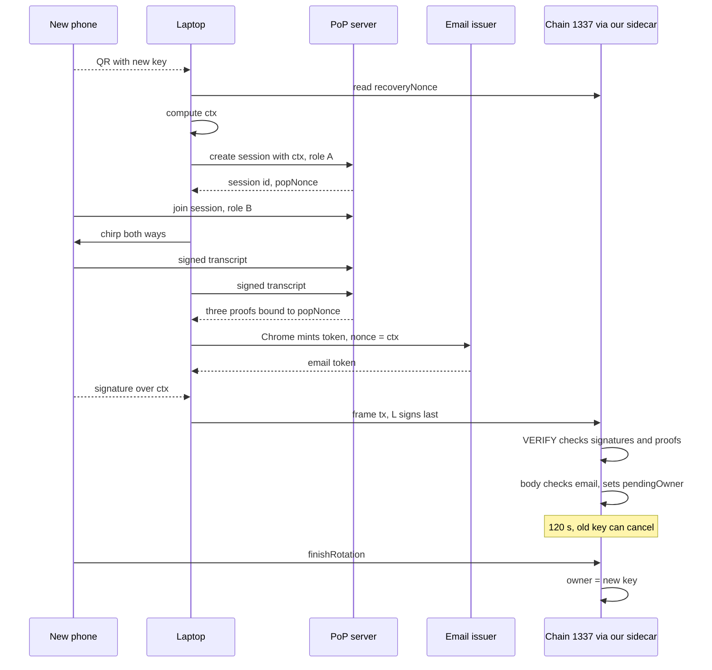
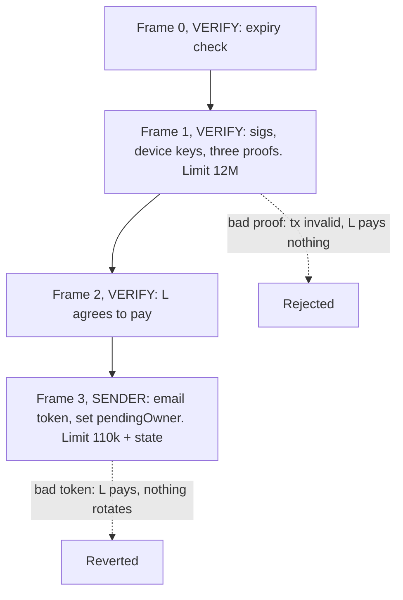
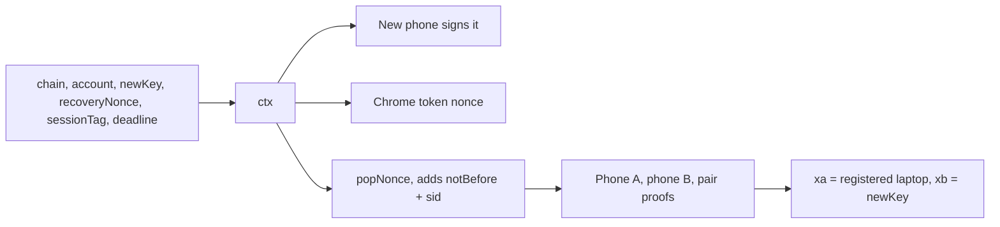
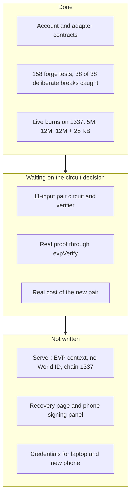

# EVP recovery: progress report

Nov 6, 2026. What we discussed, what got decided, what got built, and where we might not agree.

**Short version:** the contract now checks the ZK proximity proof instead of an unchecked label, but no real proof can pass yet. That needs one circuit change, which waits until `fv/v1` is done. The code is uncommitted.

## 1. What we're building

You lose your phone, and its key owns your smart account `A`. You move ownership to a new phone without the old key. The account stays the same and no funds move.

To start, you need three things:

1. Your email, through a Chrome EVP token.
2. Your registered laptop.
3. A ZK proof that the laptop and the new phone were near each other.

Then there's a 120 s wait when the old key can cancel, and then anyone can finish.

## 2. What we worked out

| Question | Where we landed |
| --- | --- |
| Do frame txs enable native rotation? | Yes. VERIFY reads the key from storage and a later frame writes a new one. It's account code, not a protocol command |
| How is that different from Safe? | Safe can rotate too, and most recovery logic would port to a module. The difference comes after recovery: the new phone can act alone, while a Safe always needs someone else's ECDSA key or a bundler |
| Is the new owner an EOA? | No. It's a P-256 key on the new phone, stored as an address |
| What did the old design really require? | `L` plus email. The phone's signature and the chirp didn't stop an attacker, because the contract never checked the chirp |
| Why did the research use `transcriptHash`? | Not written down. My read: laptop audio wasn't ready on Nov 3, and the verifier costs far more than the 100k cap |
| Can VERIFY run ZK? | Yes. The 100k is a mempool rule, not a protocol limit. I first said it had to go in the body, and that was wrong |
| Are devices attested? | Phones yes (Secure Enclave with App Attest, Keystore with Key Attestation). The laptop no, it's a software key. A passkey is a signing key, not attestation |
| Is it safe to make device keys public? | Safe for security. The cost is linkability, and it's small for recovery if those keys aren't reused elsewhere |

## 3. Decisions

**You decided:**

- ZK proof goes into recovery, replacing the `transcriptHash` label.
- Register the laptop in advance. The account accepts that laptop plus the new device.
- Skip the silence concern here. It's handled in the next circuit version.
- Run our own alt mempool with a raised gas limit. You confirmed it's okay with the EF team.
- Don't change the circuit now. Revisit after `fv/v1`, aligned with `fv/v2`.
- `evp-recovery` likely becomes another `examples/` app.

**I decided while building, so please check these:**

- The proof goes in VERIFY, not the body. The live burn test passed, so the workflow took that branch.
- `ctx` stays byte-identical, and its `transcriptHash` slot becomes a `sessionTag` picked before the chirp. This keeps the real-token tests.
- Roles are fixed: laptop = A, new phone = B.
- `L` stays as the payer, and the laptop also gets a separate P-256 device key for the chirp.
- `newKey` must also be the phone's PoP device key.
- The PoP issuer and verifier address are pinned in `configHash`.

**I suggested, nothing decided:**

- A recovery-only copy of the pair circuit, so normal PoP keeps its privacy.
- A dedicated laptop key, not reused for PoP meetings.
- A non-extractable WebCrypto key for the laptop, so it can't be copied.

## 4. The design now

The frame tx that starts it:

How the pieces tie together. Everything hangs off `ctx`, and the proof commits to `ctx` rather than the other way round, so there's no circular dependency:

## 5. What's built and how far it's proven

| Claim | Evidence | Level |
| --- | --- | --- |
| Contract binding logic | 158 forge tests, plus an independent review | Tested with mock proofs |
| VERIFY can spend 12M with 28 KB of data | 3 mined txs on 1337 | Live, but burn loops |
| `xa`, `xb` are the keys that signed | read from circuit source, by two agents | Read, not run |
| Real verifier cost, 11.47M | measured Nov 2 on the old 7-input pair | Measured, old circuit |
| Room left for the new pair, about 200k | burn mocks | Estimate |
| Account or adapter on an 8141 chain | none | Never run |
| Real Chrome token through the body or `evpVerify` | none. The 15 tokens pass `checkEvp` but are past the test deadline | Never run |

## 6. What this does and doesn't protect

It's stronger than before: a proximity claim is now checked on chain and tied to two named devices. It doesn't force physical presence yet.

- **Copied laptop key:** the attacker runs it on their own laptop beside their own phone and gets a real NEAR. The key has to be non-copyable, and today the web key is software.
- **Unattested laptop:** it can edit its half of the measurement.
- **Stolen unlocked laptop:** still wins, because the thief holds `L`, the device key, and the mail session.
- **Stolen phone:** still not covered. The thief can keep cancelling.

## 7. Side effects

- Chain 1337 was reset at 06:29 UTC on Nov 6, separately from this work. Old wallets are gone.
- `devnet/sidecar.sh` now uses a 16M cap, and the vendored sidecar was rebuilt.
- The probe wallet is gone, so rerun `probe-setup` first.
- Test keys in `evp-recovery/contracts/keys/` were regenerated.
- The start tx now needs our own sidecar, so the old claim that it fits the public mempool was retracted.

## 8. Open, for after `fv/v1`

1. Does the public-key pair go into `fv/v2`, or stay a recovery-only copy?
2. What's the laptop key: software for the demo, or non-extractable?
3. Does the recovery example get its own server flow? The server's roles and World ID rule don't fit it today.
4. Is CROPS App still the right prize now that the start tx needs our sidecar?
5. There's no `fv/v2/` folder yet. Which file is the rough informal spec you meant?

## 9. Where we might not be aligned

1. **"It's okay" from the EF team.** I took this to mean our own sidecar with a raised limit counts. Did it also cover judging, and proof in VERIFY?
2. **"Use the ZK properly."** I took this to mean on-chain verification of the full three-proof bundle at about 11.5M gas. A smaller Groth16 wrap was never built.
3. **"Forces presence."** You expected proximity to force the attacker to be with `L`. As built it doesn't, for the reasons in section 6. Is that acceptable for this version?
4. **Keeping `L`.** You said "L + new device". I kept `L` as the payer and added a second laptop key. Did you want one key?
