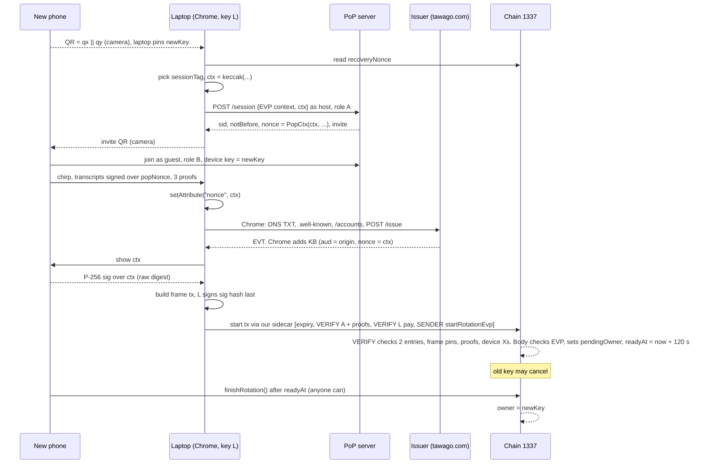

# EVP recovery: report for Nov 5

Proximity check corrected Nov 6. Read this cold. Everything below is in this folder, except the ENS spikes (`ens-half`, `ens-oracle-1337`), which aren't in this repo; `./DESIGN.md` wins where siblings disagree. Nothing was sent on chain, no DNS touched, no real keys used.

## 1. The design

1. Alice's smart account `A` on chain 1337 is owned by a P-256 key on her phone. The phone is gone.
2. On her laptop she opens the recovery page and scans a QR from a new phone. The page picks `sessionTag`, computes `ctx = keccak(DOMAIN, chainId, A, newKey, recoveryNonce, sessionTag, deadline)` and creates the PoP session with it, so the laptop is role A. The phone scans the invite and joins as role B. The two chirp over `popNonce = PopCtx(chainId, A, ctx, notBefore, sid)` and produce three proofs. The server side of this is not written (`./DESIGN.md` §5).
3. The page sets `ctx` as the EVP `nonce`. She types her email. Chrome mints `EVT~KB` from our issuer, `aud` = the page origin.
4. One EIP-8141 frame tx: new phone signs `ctx` (native P-256 entry), the enrolled laptop key `L` pays and signs the sig hash, VERIFY checks both entries, pins the body and checks the proof bundle, including that the two devices are the preregistered laptop and the new phone. The body checks the email token with 0x100 and 0x02 and sets `pendingOwner`.
5. 120 s later anyone finishes. The old key can cancel in between.
6. ENS is display only. Nothing on the critical path reads ENS or DNS. No guardian in v1; v1.1 adds one if the Nov 4 phone gate passes (`./DESIGN.md` §4.5).

## 2. New findings

| Finding | Evidence |
| --- | --- |
| ES256 JWS signatures ride as native scheme-2 entries, 6,700 each. msg = sha256(signing input), signer = keccak(x‖y)[12:] | `./poc-native-evp/README.md` §1, `entries.cjs` all pass |
| Two high-s rules. ethrex rejects a high-s *entry*; 0x100 in the body accepts high-s. 7 of 13 Chrome KB sigs were high-s. Phone entry must be low-s; token sigs left alone | `./poc-native-evp/README.md` §1, `./live-chrome/README.md` "Bytes" |
| EVP fully in VERIFY is dead: ~247,700 vs the 100k cap. Best pure-Yul SHA-256 is 176,935 for EVT+KB. The split is forced | `./poc-native-evp/README.md` §2-3, forge |
| Real Chrome 156.0.8078.80 mints a token with `nonce` = our ctx vector. 15 of 15 tokens verify in forge, 63,176 gas warm | `./live-chrome/README.md`, `live-chrome/verify` |
| Chrome 156 reads only the `nonce` *attribute*. `el.nonce = …` mints nothing, no error. Contradicts the main-branch reading in `./evp-flow.md` §1 | `./live-chrome/README.md` failure 1 |
| Header CSP (`default-src 'self'`, or nonce-CSP) plus dynamic `setAttribute("nonce")` still mints | `./live-chrome/README.md` "CSP header run" |
| Native "Verify this email automatically?" bubble stops the flow. CDP cannot click it. `--auto-grant-email-verification-permission-for-testing` skips it | `./live-chrome/README.md` failure 2 |
| `--dns-txt-resolver-url-prefix` is undocumented, in 156+, and works on stable. Local issuer test with no DNS change | `./evp-flow.md` §6, live run |
| Chrome ignores DNSSEC. It asks dns.google over HTTPS and never reads the AD bit | `./evp-flow.md` §6 (source) |
| `aud` = committed origin, no port, no slash, byte-exact. Page cannot change it. Contract pins keccak of it | `./evp-flow.md` §2, 15 live tokens |
| KB header and claim order stable (`aud, iat, nonce, sd_hash`), fresh `cnf` key per request, RFC 9421 check passed 13/13 | `./live-chrome/README.md` |
| ENS's own DNS path is broken by the root KSK 38696 rollover. The oracles ENS wires to `.com/.dev` (mainnet `0x0fc3…`, Sepolia `0xe62E…`) hold anchors 19036+20326 and revert `NoMatchingProof`. Standalone oracles with 20326+38696 pass | `./ens-oracle-1337/results.txt`, `./ens-options.md` §0 |
| Separate: ENS moved its Sepolia v2 root. `enconomy` is AVAILABLE in the new tree; UR reverts `ResolverNotFound` on our names | `./ens-half/README.md` §0 |
| The bare DNSSEC oracle runs on chain 1337: cloudflare.com chain verified in one `eth_call`, 488,307 gas. Deploy is ~25M gas, DNSSECImpl fits 2^24 with 0.6% headroom | `./ens-half/README.md` §2 |
| EIP-8037 state gas: a fresh slot costs 97,920 and a frame cannot borrow it. Fixed with `recoveryNonce = 1` and a keep word in slot 1. Body dropped 97,424 → 80,324 | `./FIXES.md` §1, `contracts/test/StateGas.t.sol` |
| Default-code pay frame reads `sig[1]`, uses 0 gas plus 3,000 entry. `L` must be entry 1 | `./REFUTE.md` §1 (ethrex source) |
| No faucet to rely on (502 twice). A throwaway genesis key is published in the sidecar repo. Block time 6 s | `./FIXES.md` §10 |
| WebCrypto and passkeys cannot be `L` or `N`: they hash before signing, no secp256k1, no raw digest. Software keys only for v1 | `./proximity.md` §2, `proximity-sigcheck` 9/9 |
| Proximity honesty: QR gives the key-input guarantee, audio adds "in earshot". One cheating endpoint fakes NEAR. `transcriptHash` was server-chosen and unchecked; replaced Nov 6 by `sessionTag`, fixed before the chirp, plus the proof bundle in VERIFY | `./DESIGN.md` §5, `./REFUTE.md` §6 |
| xa and xb in the pair circuit are the X of the keys that signed the transcripts: `check_signed` takes the signature key and `x_own` from the same bytes, `phone_core` commits it under `TAG_HALF`. X only; the other Y is the same private key negated | `./DESIGN.md` §5, oalib `lib.nr`, read from source |
| TIMESTAMP is banned in the prefix, so the ported `valid_at` window hangs off frame 0's deadline | `./DESIGN.md` §5, sidecar `frameTx.ts` |

## 3. What ENS does and doesn't do

- Does: give the account a name on Sepolia, mirror `configHash`, issuer domain, `aud`, the 1337 address (ENSIP-11), and a recovery receipt after `RotationFinished`. Written by our attester key, so only as true as that key.
- Doesn't: sit on the recovery path. The issuer key, email hash and origin are pinned in `configHash` by the owner. If ENS and the account disagree, the account wins.
- Dead today: DNS import and ENSIP-17 (stale anchors, §2). Our names through the Universal Resolver (root moved).
- Blocker: `MeetResolver` has no `setText`. Patch exists (`./ens-half/meetresolver-settext.patch`, 6 tests), but it means a new CREATE2 address and re-pointing.
- 2a (oracle on 1337 feeding an issuer registry): declined Nov 3. DS takes 1-2 days, `IssuerRegistry` unwritten, ~25M gas of 1337 ETH, dnspython is the user's run, 0.6% deploy headroom.
- Default demo: no ENS on screen. The upgrade needs five user steps by Nov 5 noon (`./DESIGN.md` §7).

## 4. What's built

| Piece | Where | Tests |
| --- | --- | --- |
| Account with the 2-sig EVP start branch, `EvpCheck`, presence adapter | `./contracts/` | 158 forge (89 logic, 50 adapter, 12 gas, 4 state gas, 3 live token), 0 fail. Proofs mocked |
| Live Chrome harness: server, CDP driver, 15 real tokens | `./live-chrome/` | 6 forge, 15/15 tokens verify against the PoC `EvpVerifier`. It does not compile this account; `contracts/test/LiveToken.t.sol` runs the same tokens through this account's `checkEvp` |
| Issuer (Cloudflare Worker shape, runs in Node) | `./issuer-worker/` | selftest all passed |
| Native-entry and Yul SHA-256 spike | `./poc-native-evp/` | 6 forge + `entries.cjs` all pass |
| ENS half: resolver patch, Sepolia mirror, oracle dry run | `./ens-half/`, `./ens-oracle-1337/` | 6 forge, 3 dry runs |
| Laptop key sanity | `./proximity-sigcheck/` | 9/9 |
| ctx vector | `./ctx-vector.json` | read by forge at test time |

Gas (forge 1.4.3, Osaka pricing, cold). Modeled = measured + 3,000 entry (+400 per cold account in VERIFY: the helper, and in start frame 1 also the adapter and two verifiers). Frame 1's measured number has mock proofs. Its modeled number adds 11,473,237 cited from `../poc-verifier-gas/README.md`, phone 4.07M x2 + pair 3.31M, for the OLD 7-input pair. The 11-input pair has never been measured. That sum ignores EIP-150 forwarding. Burn mocks through the real account and adapter at the 12M limit fit a pair of up to 3,524,568 against 3,320,074 cited, so the margin for the 11-input pair is about 204,000 (`test_budget_start_frame1_forwarded`, no real verifier).

| Frame | Measured | Modeled | Limit |
| --- | ---: | ---: | ---: |
| start 0 expiry | - | ~3,050 | 4,000 |
| start 1 A VERIFY | 82,905 mock | 11,560,742 plain sum, ~204,000 margin after 63/64 | 12,000,000 |
| start 2 L pay (default code) | - | 0 + 3,000 | 8,000 |
| sig entries 6,700 + 2,800 | | 9,500 | |
| **start prefix** | | | **12,021,500 / 16,000,000**, our sidecar only |
| start 3 body (EVP + pending write) | 80,461 | 83,461 | 110,000 exec; state from estimate, floor 100,000 |
| start frame 3 calldata (1,316 B) | | 19,028 | |
| start frame 1 data (30,052 B) | | 462,832 | |
| **start tx, EIP-7825** (state excluded) | | **12,627,388** | **16,777,216** |
| EVP check alone, live token | 63,176 | | |
| cancel 0 VERIFY / 1 body | 7,303 / 11,783 | 10,703 | 12,000 |
| finish 0 VERIFY / 1 body | 11,460 / 13,795 | 14,860 | 18,000 |
| ENS, optional: Sepolia config mirror / receipt | 1,213,893 / 839,008 | | |
| ENS, optional: 1337 oracle deploy / one proof | 16,505,055 / 488,307 | | |

## 5. Proven vs untested

Proven (forge or a local run):
- The shared vector's ctx, recomputed by the account. A script-minted token (`GOOD`) with that nonce reaches the body. VERIFY tests use a script-minted token over a real P-256 phone key (`GOOD_PHONE`), since `0xeeee..` has no (qx, qy).
- 15 real Chrome tokens pass this account's `EvpCheck` through `checkEvp` (`contracts/test/LiveToken.t.sol`).
- Replay dies in VERIFY (`recoveryNonce`), junk tokens cost `L`, relayer cannot swap fields, other `aud` fails, 3-sig guardian path still green.
- No start writes a fresh slot.
- With mock Honk verifiers only: VERIFY refuses a wrong laptop device, wrong new device, wrong nonce and wrong verifier config. Real POPCC1 signatures, real adapter.
- Oracle and Sepolia numbers, by `eth_call` and `eth_estimateGas` with state overrides.

Never run:
- A real proof through `evpVerify`. The 11-input pair circuit, VK and verifier do not exist; the circuits are frozen and that change is gated on the user.
- A real Chrome token through the account's body or `evpVerify`. The 15 tokens were minted about 8 days past the vector's deadline, so the body reverts `Expired`, and they name `0xeeee..`, so frame 1 cannot take them (`test_liveToken_cannotReachBody`).
- The session sequence in §1 against a real server.
- This account or the adapter on any chain. The 12M + 28,000 B probe was a burn loop.

Untested:
- Anything on an EIP-8141 chain. 0x100 and 0x02 inside a SENDER frame, the real pay-frame cost, per-frame state estimate, `ethrex_simulateFrameTransaction` on the real tx.
- Phone raw-digest signing on a phone (Pixel, iPhone). Gates only v1.1 and the native-app upgrade.
- Whether one manual "Verify" click persists.

Not written: `evp-start-shape.cjs`, the recovery page (keccak, `L` keygen, QR via `BarcodeDetector`, session create, tx build), the phone signing panel, the server's EVP context kind and no-World-ID path (`./DESIGN.md` §5), a prover wired to this flow, the issuer on real paths, ENS wiring. Nothing in this folder implies the page exists.

## 6. Threats

| Attacker | Result | Why |
| --- | --- | --- |
| Remote phisher, own page or reverse proxy | stopped | `aud` is their origin; `newKey` only via QR + chirp; no `L` |
| Issuer key compromise | stopped | can mint any EVT, cannot sign with `L` |
| DNS takeover of `_email-verification` | stopped | account pins the old key; DNS not on the chain path |
| Replay, malleated twin | stopped | ctx carries `recoveryNonce` + `deadline`; `iat` window |
| Griefing `A` with junk txs | stopped | `L` pays |
| Relayer | nothing to gain | sig hash commits to every byte |
| XSS / bad deploy on the origin | **falls** | `L` is script-readable, Chrome mints with no prompt. CSP + no deps + 120 s window |
| Stolen unlocked laptop, mail signed in | **falls** | thief holds `L` and the session. Brakes: 120 s, old phone cancel (absent in lost-phone) |
| Cloudflare login | **falls** | DNS, registrar, Pages, mail in one login. Same as XSS |
| Server lies NEAR, or a cheating phone relays | server alone: no verdict on chain, once the 11-input pair exists. Cheating phone, with or without the server: falls, proximity leg only | proofs checked in VERIFY, with transcripts signed by both device keys; still needs `L` and the session; `newKey` is pinned from the QR |
| Stolen phone (thief holds owner) | **not covered** | thief drains and cancels forever. Needs a guardian veto |
| Early finish, restart while pending | accepted | only `N` / only `L` + session; disclosed |

## 7. Prize fit

**Corrected Nov 6: the start tx is not canonical-mempool admissible.** It checks three proofs in VERIFY, prefix 12,021,500 against the public 100,000, and calls precompiles and a foreign verifier there. It relies on our own sidecar (`../devnet/sidecar.sh`: 16M cap, precompiles allowed). Earlier versions of this section said the canonical mempool admits it as is; that stopped being true when the proofs moved into VERIFY. Whether judges accept our own sidecar, and whether CROPS App is still the right prize, is open. Cancel and finish keep the public shape.

- C: rule is contract code, no keeper. Any node running our sidecar config relays the start; the public one rejects it. Issuer and server can deny, not forge.
- O: MIT at repo root is still TODO (first event commit).
- P: the email string is in calldata. Public. Say it.
- S: email proof + enrolled laptop key + a phone in earshot of the laptop, as far as its mic can tell + 120 s owner cancel.

`L` is a non-canonical payer: one `L`-paid tx pending at a time. Fine on stage.

## 8. To-do before Nov 5 (only you can do these)

| When | What | Unlocks |
| --- | --- | --- |
| Nov 3 | Decide ENS: re-register `enconomy.eth` in the new tree, or cut ENS from the screen. Don't rerun `ens.sh bootstrap` blind | any ENS on stage. Hard cutoff Nov 5 noon JST |
| Nov 3-4 | DNSSEC on tawago.com: optional now that 2a is off. `./ens-options.md` §4 said "turn it on today"; `./DESIGN.md` §7 supersedes. Free if unused | nothing on the critical path |
| Nov 4 | Phone raw-digest signing test, Pixel and iPhone (`../poc-phone-signing`) | v1.1 guardian, native-app phone key |
| Nov 4 | `_email-verification.tawago.com TXT "iss=tawago.com"`. Mind dns.google's 30 min negative cache | real issuer discovery |
| Nov 4 | `recover.tawago.com` CNAME + Pages deploy; Worker at the apex (`/.well-known/*`, `/evp/*`) | the real `aud` origin, real issuer paths |
| Nov 4 | CORS + a trusted cert on the sound-bound server, or accept plan A | Pages page talks to the LAN |
| Nov 4 night | Commit `research/ethglobal-mumbai/` before the event, add LICENSE (MIT) | CROPS continuity + FOSS |
| Nov 5 09:00 | Fund a deployer and `L` from the genesis key (gas limit 250,000). Deploy `A` with the plan-A `aud`. Then `ethrex_simulateFrameTransaction` with `trace: true` | every MODELED number → MEASURED |
| Nov 5 noon | ENS go/no-go | §7 upgrade |
| Nov 6 noon | v1.1 go/no-go (phone gate + v1 green) | guardian in the room |
| Demo day | Pin Chrome 156, compare block timestamp with laptop clock (60 s skew), `L` balance ≥ `total_gas_limit × maxFee` incl. state limits (now about 12.73M × maxFee), name the switches on stage | no silent failures |

Each missing row means plan A: `live-chrome/launch.sh`-style Chrome with `--host-resolver-rules` mapping `recover.tawago.com` and `tawago.com` to one local server. `aud` stays the real string.

## 9. Questions for the EF team, Nov 5

1. Which ethrex and sidecar commits does the Mumbai devnet run? Is cold SLOAD 2,100 or 3,000 (EIP-8038)? At 3,000 frame 1 loses a few thousand of its roughly 204,000 margin.
2. Do 0x100 and 0x02 work inside a SENDER frame of a frame tx on your devnet? Our body depends on it.
3. What does the default-code pay frame of an EOA really cost? Source says 0 used + 3,000 entry.
4. Is `estimateFrameTransactionGas`'s per-frame `state` number the one to put in `limits.state`? Any per-tx state-gas cap?
5. Faucet: is it back? Is the published genesis key still the way to fund on 1337? Does the Mumbai devnet match `altmempool.forshtat.com`?
6. Non-canonical payer cap of one pending tx: stays at the event?
7. CROPS eligibility: the start is not public-mempool admissible. It needs our own sidecar with the 16M cap and precompiles allowed. Does that count, or do you expect another shape?
8. Is `skandha_config.precompiles` still `[]`? If filled, EVP in VERIFY is worth a second look (still ~247k, so no, but ask).

